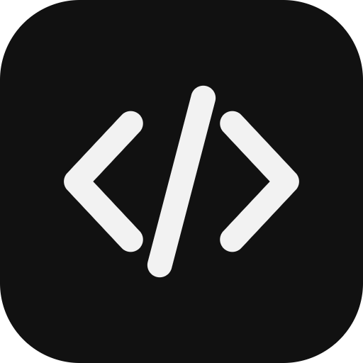
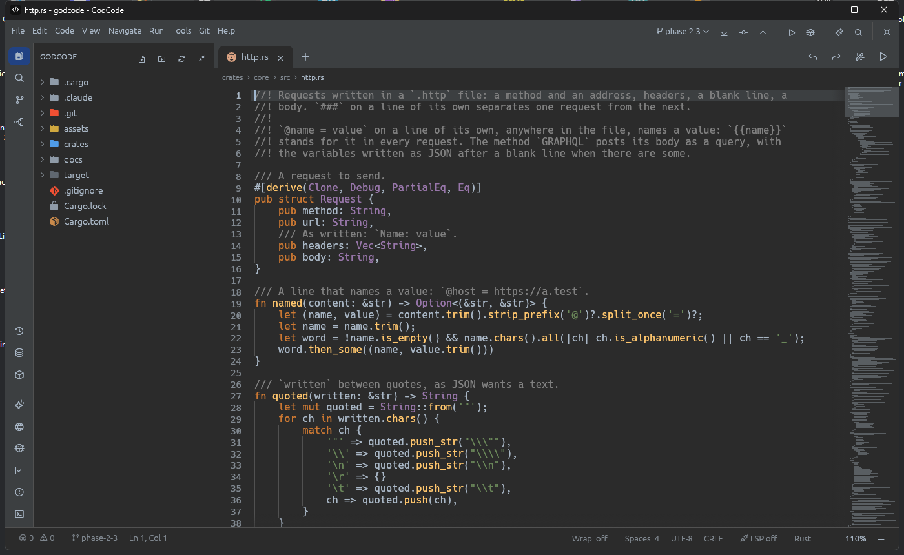

<p align="center"></p>

<h1 align="center">GodCode</h1>
<p align="center">A code editor written in pure Rust. Local first: no account, no cloud, no telemetry.</p>

<p align="center"></p>

## Download

Windows: get `GodCode-windows-x64.exe` from the [latest release](https://github.com/0XLUC4/GodCode/releases/latest).
It is a single file, nothing to install. It is not signed, so Windows SmartScreen may ask before running it.

## What it does

**Editing**
- Its own text field: syntax colours for 76 languages, folding, minimap, sticky scroll, soft wrap, several carets, column selection
- Completion: fuzzy matching, snippets, words of the files, structures such as `main`, `for`, `class` in the main languages
- Writing helps: auto-closing pairs and tags, surround the selection, smart indentation, Emmet, comment continuation, cut or copy a whole line
- Vim and Emacs keys: registers, macros, marks, `:s`, `:g`
- Large files: plain text up to 64 MB

**Languages**
- Language servers (LSP): diagnostics, completion, go to definition, rename, inlay hints, folding, quick fixes
- Debugger (DAP): breakpoints with conditions, call stack, variables you can change, watches

**Project**
- Explorer, search in files, structure view, command palette, split editors, tabs you can drag
- Git: commit panel with a tick per file, pull, push, fetch, branches, stash, log, graph, blame, diff, three-column merge view
- Run tasks, tests with results, coverage in the margin, terminal

**Tools**
- HTTP client for `.http` files, with environments and WebSocket (`ws://`)
- Live web preview inside the window
- Database windows: SQLite files (read-only, with `SELECT`) and PostgreSQL
- Docker: containers, images, compose
- Assistant: a local model through Ollama, or Anthropic with your own key; it can propose an edit you review first
- Plugins: WebAssembly modules run in a sandbox

**Looks**
- Six themes plus your own, a font of your choice, layouts you can save, Zen mode

## State of the project

GodCode is young. Everything listed above is built and covered by tests, but a good part of it has only been
tried against test doubles, not real services: PostgreSQL, the assistant, MCP tools, Docker and the WebSocket
client in particular. The PostgreSQL client has no encryption and is meant for a local or development server.
Expect rough edges, and please report what breaks.

The plan, phase by phase, with what is done and what is not: [docs/PLAN.md](docs/PLAN.md) (in French).

## Build

Requires a recent Rust toolchain (built here with 1.94).

```sh
cargo run --release -p godcode
cargo test --workspace
```

## Workspace

| Crate | Role |
|-------|------|
| `crates/core` (`godcode-core`) | Text logic with no interface: syntax, completion, editing, Vim, Git parsing, SQLite reader, merge |
| `crates/lsp` (`godcode-lsp`) | Language server and debug adapter clients |
| `crates/app` (`godcode`) | The `egui`/`eframe` desktop app |

Two dependencies go beyond pure Rust code of our own: `wry` for the embedded web preview (the system web view,
Windows only) and `wasmi` to run plugins.

## License

MIT OR Apache-2.0. The file-type icons use the [Devicon](https://devicon.dev) font (MIT), see `assets/devicon-LICENSE.txt`.
